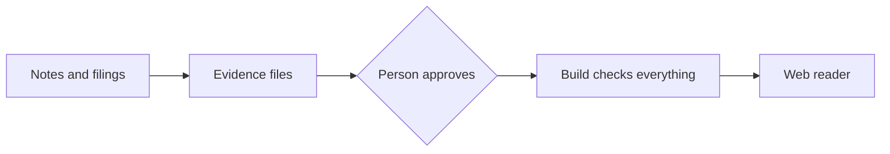

# semi-stocks-2

A research pipeline for semiconductor and AI-infrastructure companies. Notes
and public filings become structured evidence, a person approves what gets
through, and a small web app shows it, with every row linked to its source.



Claude drafts the summaries and proposed changes. Only what a person marks
`accepted` reaches the reader, and the build enforces that in code, with tests.

```bash
uv run python canonical/40-engine/site_data.py --validate
cd canonical/site-reader && npm ci && npm test && npm run dev
```

Needs Python 3.10 with uv, and Node.js 18+. Not investment advice.
