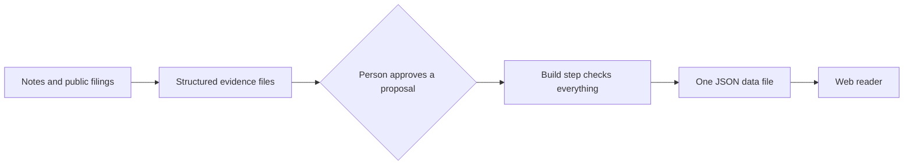

# semi-stocks-2

A small research pipeline that turns notes and public filings about
semiconductor and AI-infrastructure companies into one checked data file, plus
a browser app (Signal Desk) for reading it.

It exists to keep research evidence traceable: a company only shows up in the
reader after a person approves it, and every row links back to its source.



> Not investment advice. This is a personal research and engineering project.

## What it does

1. **Collect.** Source material (earnings-call transcripts, quarterly 13F
   holdings filings from public funds, industry research notes) lands as
   Markdown in `canonical/10-wiki/`.
2. **Structure.** Facts worth tracking become YAML in `canonical/20-data/`.
3. **Approve.** A change to the tracked set of companies is written as a
   proposal file with status `proposed`, `accepted` or `rejected`. Only
   `accepted` proposals let a company and its evidence through.
4. **Build.** A Python step (`canonical/40-engine/`) drops anything without
   an approved path to it, validates the rest and writes
   `canonical/site-data/signal_desk.json`.
5. **Read.** A React app (`canonical/site-reader/`) loads only that JSON and
   offers search, filters (source, company role, theme, date), an evidence
   table, company profiles and a graph of companies that share evidence.

Separately, `agents/` holds scheduled helper scripts: an earnings calendar,
a transcript fetcher, template-based pre-earnings predictions, a scorer that
grades them after results arrive, and an HTML report. They read the main data
but write only inside `agents/`, as drafts for a person to review.

**Current state:** the repo ships with an empty baseline. No proposals are
accepted, so the build succeeds with zero companies and the reader shows its
empty state. `agents/state/signals/` has sample dated signal files.

## Run it

Needs Python 3.10 with [uv](https://docs.astral.sh/uv/), and Node.js 18+.

```bash
# Build and validate the data file, then run the Python contract tests
uv run python canonical/40-engine/site_data.py --validate
uv run python canonical/40-engine/tests/test_signal_desk_contract.py

# Web reader at http://127.0.0.1:5173/
cd canonical/site-reader
npm ci
npm run dev -- --port 5173

# Reader tests: unit, then browser (first run: npx playwright install chromium)
npm test
npm run test:e2e
```

## What is tested

- **Data contract (12 Python tests).** The reader's company list equals the
  approved set; every row, source document, graph node and edge belongs to an
  approved company; every row cites a source document and has a date field;
  unapproved proposals never reach the feed; emitted fund positions never
  exceed what the source filing holds; claims never create graph edges.
- **Filter logic (3 Vitest tests).** OR within a filter and AND across
  filters; undated rows follow the "include undated" switch; search combines
  with source filters.
- **Browser (3 Playwright tests).** The page renders its counts, edge
  selection explains itself, and an over-filtered graph explains its empty
  state. The edge test needs at least one graph edge, so it cannot pass on
  the empty baseline described above.

## Design choices worth noticing

- **A human gate, enforced in code.** Approval is not a convention: the build
  computes the set of approved companies and source documents first, and
  every output is filtered against it, and the tests check each output.
- **One-way data flow.** Data moves from notes to evidence to build output to
  reader, never back. `canonical/site-data/` can be deleted and rebuilt at
  any time; the reader never reads the source YAML.
- **Repeatable builds.** Each build records a SHA-256 hash of every input
  file and of each output collection. Rebuilding from the same inputs changes
  only the timestamp, so a diff shows real data changes.
- **The build fails loudly.** Without a schema library, validation rejects
  unknown edge types, links to missing records, duplicate IDs and companies
  without a ticker or name.
- **An honest graph.** A line between two companies means only "these share
  evidence" (both held by the same fund, or named in the same signal). It
  never claims supplier, customer or money flow. A path-tracing feature is
  deliberately switched off until typed relationship data exists, and a test
  keeps it off.
- **Code fetches, people judge.** Agent scripts gather and template data
  without a language model; each prediction names the earnings report that
  will grade it.

## Layout

| Path | Holds |
|---|---|
| `canonical/10-wiki/` | Source notes; `raw/` is never edited |
| `canonical/20-data/` | Structured evidence and approval proposals |
| `canonical/30-thesis/thesis.yaml` | The short list of current conclusions |
| `canonical/40-engine/` | Python build, validation and tests |
| `canonical/50-reports/` | HTML report (`uv run python canonical/40-engine/report.py`) |
| `canonical/site-data/` | Generated JSON (rebuildable) |
| `canonical/site-reader/` | React + Vite reader and its tests |
| `agents/` | Scheduled helper scripts and their drafts |
| `docs/` | Architecture notes, process docs, diagrams |

Numbered folders follow the order data moves. Write rules:
[docs/architecture.md](docs/architecture.md).

## License

No license file is included, so default copyright applies. Reader third-party
notices: [THIRD_PARTY_NOTICES.md](canonical/site-reader/THIRD_PARTY_NOTICES.md).
