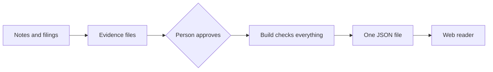

# semi-stocks-2

A research pipeline for semiconductor and AI-infrastructure companies. Notes
and public filings become structured evidence, a person approves what gets
through, and a small web app shows it with every row linked to its source.



- **Claude drafts, a person decides.** Claude writes the summaries, signals
  and proposed changes. Only proposals a person marks `accepted` reach the
  reader, and the build enforces that in code, with tests.
- **Traceable and repeatable.** Every row cites a source; each build records
  a hash of its inputs, so a rebuild changes only the timestamp.
- **Honest graph.** A line between two companies means "these share
  evidence", never supplier or customer.

## Run it

Needs Python 3.10+ with [uv](https://docs.astral.sh/uv/) and Node.js 18+.

```bash
uv run python canonical/40-engine/site_data.py --validate
uv run python canonical/40-engine/tests/test_signal_desk_contract.py
cd canonical/site-reader && npm ci && npm test && npm run dev
```

The repo ships with no approved companies, so the reader starts empty.
Folder rules: [docs/architecture.md](docs/architecture.md).

Not investment advice. A personal research and engineering project.
